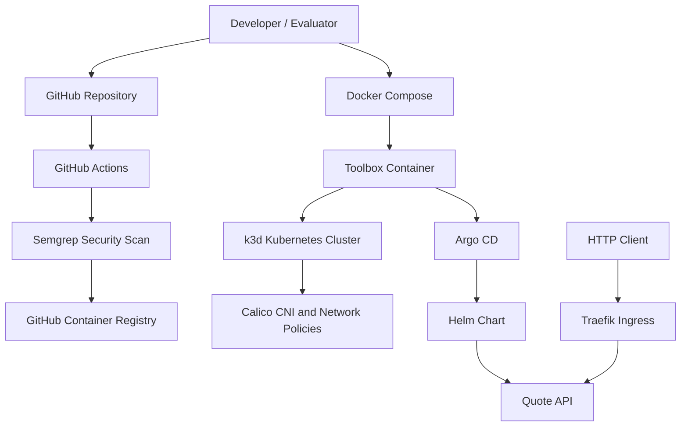

# DevOps Engineer – Take-Home Assessment

## 1. Project Overview

This repository contains the implementation of the DevOps Engineer take-home assessment.

The project demonstrates:

- Containerized Python Quote API.
- Local Kubernetes environment using k3d.
- Four Kubernetes worker nodes with different capacity labels.
- Calico networking and Kubernetes NetworkPolicies.
- Helm-based application deployment.
- Argo CD GitOps continuous delivery.
- Spot-node disruption and application recovery testing.
- Kubernetes troubleshooting and remediation.
- GitHub Actions CI/CD with Semgrep security scanning and GHCR image publishing.

## 2. Architecture



### Kubernetes node layout

| Node | Capacity / Type | Purpose |
|---|---|---|
| Agent 0 | Spot | Application workload |
| Agent 1 | Spot | Application workload |
| Agent 2 | On-demand | Application availability |
| Agent 3 | GPU | GPU workload placement |
| Server 0 | Control plane | Kubernetes control plane |

The worker nodes are labelled using:

- `acme.io/capacity=spot`
- `acme.io/capacity=on-demand`
- `acme.io/node-type=gpu`

The GPU node also uses the `nvidia.com/gpu=true:NoSchedule` taint.

## 3. Prerequisites

- Docker Desktop with WSL2 integration.
- WSL2 Ubuntu.
- Git.
- Internet connectivity to download container images and Kubernetes components.

The toolbox container provides:

- kubectl
- Helm
- Terraform
- k6
- k3d
- Docker CLI
- Git and supporting utilities

## 4. Quick Start

Clone the repository:

```bash
git clone https://github.com/balat-ops/devops-takehome.git
cd devops-takehome
```

Start the environment:

```bash
docker compose up -d
```

Run the assessment:

```bash
./scripts/run-all.sh
```

The golden-path workflow:

1. Starts the toolbox and k3d environment.
2. Installs Calico networking.
3. Prepares Kubernetes worker-node labels and taints.
4. Runs the Kubernetes troubleshooting assessment.
5. Deploys the Quote API through Argo CD.
6. Runs application smoke tests.

The toolbox provides the Kubernetes command-line environment. The scripts support execution from the repository host and delegate Kubernetes operations to the toolbox.

## 5. Quote API

The application is a Python Flask-based HTTP service.

### Endpoints

| Endpoint | Description |
|---|---|
| `/healthz` | Liveness health check |
| `/readyz` | Readiness health check |
| `/metrics` | Prometheus metrics |
| `/api/quote` | Returns a random quote |

The application exposes a custom Prometheus request counter and performs approximately 100 ms of simulated CPU work for quote requests.

### Container security

The Docker image uses:

- Multi-stage build.
- Python slim base image.
- Non-root application user.
- Gunicorn application server.

The Kubernetes deployment additionally uses:

- Non-root security context.
- Read-only root filesystem.
- Dropped Linux capabilities.
- Temporary writable volume for `/tmp`.
- CPU and memory requests and limits.

## 6. Kubernetes Deployment and GitOps

The application is packaged using the Helm chart under:

`helm/quote-api/`

The chart includes:

- Deployment.
- ClusterIP Service.
- Traefik Ingress.
- Horizontal Pod Autoscaler.
- Pod Disruption Budget.

The deployment starts with three replicas. The HPA is configured with a minimum of three and maximum of ten replicas, targeting 70% CPU utilization.

The Pod Disruption Budget requires at least two available replicas.

Argo CD manages the application using:

`argocd/application.yaml`

Automated synchronization, pruning, and self-healing are enabled.

The Helm image tag is pinned to a specific Git SHA. Image publishing and changing the Helm image tag are separate operations in this implementation.

## 7. Spot-Node Reclaim Drill

The reclaim drill demonstrates application resilience during a spot-node disruption.

Run it separately:

```bash
docker compose exec toolbox bash /workspace/scripts/25-reclaim-drill.sh
```

The script:

1. Identifies a Ready spot node hosting a Quote API pod.
2. Checks application replica health and PDB disruption allowance.
3. Starts continuous HTTP health checks.
4. Drains the selected spot node.
5. Waits for application replicas to recover.
6. Reports HTTP health-check results.
7. Uncordons the drained node during cleanup.

### Validation results

Tested by draining `k3d-devops-assessment-agent-1`.

| Validation | Observed result |
|---|---|
| Initial application replicas | 3/3 Ready |
| PDB allowed disruptions | 1 |
| Spot-node drain | Successful |
| Application recovery | 3/3 Ready |
| HTTP health checks | 12 successful HTTP 200 responses |
| HTTP failures | 0 |
| Node uncordon | Successful |
| Final cluster status | All 5 nodes Ready |

The PDB initially rejected an eviction that would have violated the disruption budget. Kubernetes retried the eviction after availability recovered.

The two affected Quote API replicas were rescheduled onto another spot node, while the on-demand replica remained available.

## 8. Kubernetes Troubleshooting Assessment

The troubleshooting manifests are located under:

`troubleshoot/`

| File | Purpose |
|---|---|
| `broken-app.yaml` | Manifest containing intentional configuration issues |
| `fixed-app.yaml` | Corrected Kubernetes resources |
| `prepare.sh` | Prepares node labels and taints |
| `verify.sh` | Runs troubleshooting validation checks |
| `smoke-job.yaml` | Connectivity test workload |

The remediation addresses:

- Invalid container image tag.
- Excessive resource requests and limits.
- Incorrect health probe port.
- Volume name mismatch.
- Incorrect Service selector and target port.
- Incorrect GPU node selector.
- Missing GPU toleration.
- NetworkPolicy ingress, egress, and DNS requirements.

The default-deny NetworkPolicy is retained, with the required application and smoke-test connectivity explicitly allowed.

Run the troubleshooting validation through:

```bash
docker compose exec toolbox bash /workspace/scripts/30-troubleshoot.sh
```

## 9. CI/CD and Security Scanning

The GitHub Actions workflow is located at:

`.github/workflows/ci.yml`

The pipeline includes:

1. Semgrep security scanning of the Python application.
2. Docker image build.
3. Authentication to GitHub Container Registry using `GITHUB_TOKEN`.
4. Image publishing using the Git commit SHA as the image tag.

The security scan is a required dependency of the image publishing job. A failed security scan prevents image publishing.

Pull requests run the security scan without publishing an image.

Published image:

`ghcr.io/balat-ops/quote-api`

The image tag is an immutable Git SHA.

See `MIGRATION-NOTES.md` for CI/CD migration details.

## 10. Repository Structure

```text
.
├── .github/workflows/
│   └── ci.yml
├── app/
│   └── main.py
├── argocd/
│   └── application.yaml
├── calico/
│   ├── custom-resources.yaml
│   ├── tigera-operator.yaml
│   └── v3_projectcalico_org-v1beta1.yaml
├── helm/
│   └── quote-api/
├── scripts/
│   ├── 00-bootstrap.sh
│   ├── 05-install-calico.sh
│   ├── 20-deploy.sh
│   ├── 25-reclaim-drill.sh
│   ├── 30-troubleshoot.sh
│   ├── 40-smoke-test.sh
│   └── run-all.sh
├── toolbox/
│   └── Dockerfile
├── troubleshoot/
│   ├── broken-app.yaml
│   ├── fixed-app.yaml
│   ├── prepare.sh
│   ├── smoke-job.yaml
│   └── verify.sh
├── Dockerfile
├── docker-compose.yml
├── k3d-config.yaml
├── requirements.txt
├── AI-USAGE.md
├── OPS-ANSWERS.md
└── README.md
```

## 11. Script Reference

| Script | Purpose |
|---|---|
| `00-bootstrap.sh` | Creates and prepares the local Kubernetes environment |
| `05-install-calico.sh` | Installs Calico networking |
| `20-deploy.sh` | Installs Argo CD and deploys the application |
| `25-reclaim-drill.sh` | Tests spot-node disruption and application recovery |
| `30-troubleshoot.sh` | Applies and validates troubleshooting fixes |
| `40-smoke-test.sh` | Tests application endpoints and Prometheus metrics |
| `run-all.sh` | Runs the main assessment workflow |

The reclaim drill is intentionally separate from `run-all.sh` because it performs a disruptive node-drain operation.

## 12. Design Decisions and Trade-offs

- **k3d:** Provides a lightweight, reproducible local Kubernetes environment without requiring a managed Kubernetes cluster.
- **Calico:** Provides CNI networking and Kubernetes NetworkPolicy enforcement.
- **Argo CD:** Demonstrates GitOps-based deployment and reconciliation.
- **Helm:** Keeps Kubernetes application configuration reusable and parameterized.
- **Pod Disruption Budget:** Protects application availability during voluntary disruptions.
- **Spot/on-demand placement:** Demonstrates workload scheduling across different capacity types while retaining an on-demand replica.
- **Git SHA image tags:** Provides traceability between source commits and container images.
- **Separate reclaim drill:** Prevents a disruptive node-drain test from running automatically during every assessment execution.

The environment is a local k3d implementation. It demonstrates Kubernetes scheduling and recovery behavior but does not reproduce actual cloud-provider spot interruption notifications or managed GPU hardware.

## 13. Troubleshooting Notes

### Toolbox cannot access Kubernetes

Check the toolbox:

```bash
docker compose ps
docker compose exec toolbox kubectl config current-context
```

Expected context:

```text
k3d-devops-assessment
```

### Check Kubernetes nodes

```bash
docker compose exec toolbox kubectl get nodes
```

### Check application pods

```bash
docker compose exec toolbox kubectl get pods -n default -o wide
```

### Check Argo CD application

```bash
docker compose exec toolbox kubectl get applications -n argocd
```

### Check application endpoints

```bash
curl -H "Host: quote.local" http://localhost:8080/healthz
curl -H "Host: quote.local" http://localhost:8080/readyz
curl -H "Host: quote.local" http://localhost:8080/api/quote
```

### Inspect application logs

```bash
docker compose exec toolbox kubectl logs deployment/quote-api -n default
```

## 14. Additional Documentation

- `AI-USAGE.md` – AI assistance disclosure and validation approach.
- `OPS-ANSWERS.md` – Operational and architecture questions.
- `MIGRATION-NOTES.md` – CI/CD migration details.
- `TROUBLESHOOTING.md` – Troubleshooting symptoms, diagnosis, root causes, and fixes.

## 15. Scope

The implementation focuses on the core Kubernetes, application, troubleshooting, and CI/CD requirements, with Part 4 selected from the additional assessment options.

Optional GPU autoscaling and Cloudflare Terraform implementation, and the separate Prometheus/Grafana load-testing exercise, are not claimed as completed deliverables.